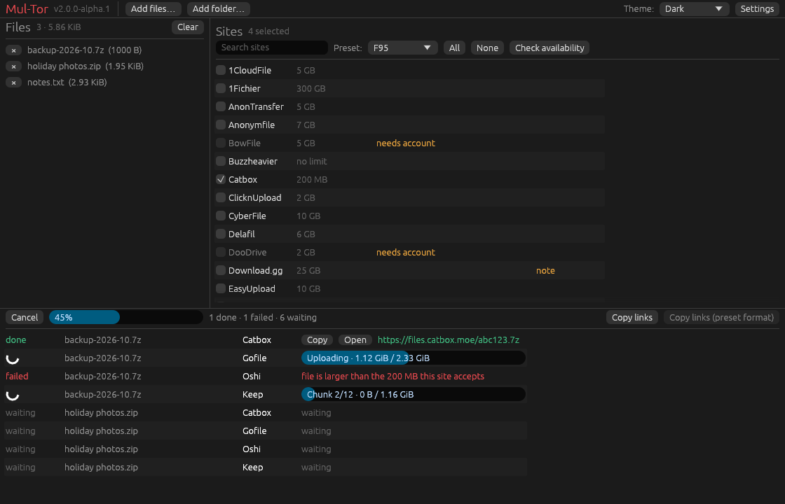

# Mul-Tor

**Upload a file to many file-hosting sites at once.** Built for backups, archiving
and sharing: pick the files, pick the hosts, get all the links.

> [!NOTE]
> **Mul-Tor 2.0 is a rewrite in Rust** (not released yet). It ships as a single
> native program for Linux, macOS and Windows: a command-line tool (`mul-tor`)
> and a graphical one (`mul-tor-gui`, built on egui/wgpu). The Python 1.x
> version lives on in the git history (tag `1.5.2`).

## Status

* All 37 sites of the Python version are ported.
* Every uploader is tested against a local mock server that checks the exact
  HTTP requests it sends (field names, headers, chunk boundaries). **They have not
  been re-verified against the live services**; the protocols come from the 2024
  Python code, and file hosts change often. If a site fails, `runtime.log` has
  the details; please [open an issue](https://github.com/Official-Husko/mul-tor/issues/new/choose).
* New sites are being added; see [docs/ADDING_SITES.md](docs/ADDING_SITES.md).

## Features

* Interactive guided mode, plus a scriptable `upload` command (`--json`, exit codes)
* Several uploads at once (`--parallel`), with a progress bar for every upload
* Site presets (a list of sites + a link format for a forum or community)
* Optional random user agent, public proxy pool, or your own proxy (HTTP/SOCKS, so Tor works)
* Checks which sites are reachable before offering them
* Writes every link to `file_links.txt` (and a BBCode-style version for presets)
* Notifies you about new releases (it never installs anything by itself)

## Install

Pre-built binaries will be attached to the
[releases](https://github.com/Official-Husko/mul-tor/releases). Until then, build
from source with a [Rust toolchain](https://rustup.rs) (1.89 or newer; the graphical
version needs 1.95):

```sh
cargo install --path crates/cli      # the command-line tool: `mul-tor`
cargo install --path crates/gui      # the graphical tool:    `mul-tor-gui`
```

The command-line tool has no system dependencies. Static, self-contained builds
are possible (for example with the `*-unknown-linux-musl` targets).

## Using the graphical version

`mul-tor-gui` is the same engine in a window (egui, rendered with wgpu): drop files
on it, tick sites or pick a preset, press Upload. Every upload gets its own
progress bar and, once finished, a link you can copy or open. Settings (including
your accounts) are edited in the window and saved to the same `config.toml`.



*The window part-way through a run (rendered with sample data).*

It needs a GPU driver that supports Vulkan, Metal or Direct3D 12, which any recent
desktop has. On Linux it also loads a few system libraries at run time
(`libxkbcommon-x11`, `libwayland-client` or X11, and `libvulkan`); a minimal or
containerised install may be missing them, and the command-line version needs
none of this.

## Using the command line

```sh
mul-tor                                   # guided mode: pick files, pick sites
mul-tor sites                             # what is supported, limits, accounts
mul-tor upload backup.7z -s pixeldrain -s gofile
mul-tor upload ./release --preset f95 --parallel 3
mul-tor upload photos/ -r --all --json    # one JSON object per upload, for scripts
mul-tor check                             # which sites answer right now?
```

* A folder contributes the files directly inside it; add `-r` for sub-folders.
* `--site` names are forgiving: `Transfer.sh`, `transfer_sh` and `transfersh` are the same.
* Exit code `0` = everything uploaded, `1` = at least one upload failed,
  `2` = bad usage or configuration, `130` = cancelled with Ctrl-C.
* Failures are explained on screen and logged in `runtime.log`, including a
  trimmed copy of what the site replied.

## Configuration

Settings live in `config.toml`; `mul-tor config path` prints where. The first run
creates a fully commented one. To keep everything in one folder (a portable
install), use `--home DIR` or set `MUL_TOR_HOME`.

Sites that need an account are hidden until you fill in their credentials:

```toml
[credentials.Pixeldrain]
apiKey = "..."
```

`mul-tor sites` shows which sites need one, and the table below links to where
you get the keys. **The file contains secrets and is created readable only by you
on Linux/macOS.**

### Coming from the Python version?

* Your old `config.json` in the folder you start Mul-Tor from is imported
  automatically the first time (the original is left alone).
* `file_links.txt` still goes to the current folder by default (`links_dir` changes that).
* Presets are the same JSON files; put your own in the `presets` folder next to `config.toml`.
* `Transfer.sh` and `Download.gg` could not be selected in 1.x because of a
  naming bug; they work (or fail on their own merits) now.

## Presets

A preset lists the sites a forum or community accepts and how to format the links
for a post. `mul-tor presets` lists them; `mul-tor upload ... --preset f95` uses one.
The bundled ones are in [presets/](presets/); the format is documented in
[presets/template.json5](presets/template.json5). Sites a preset names that
Mul-Tor does not support yet are reported rather than silently dropped.

## Supported sites

Regenerate with `mul-tor sites --format markdown`. Limits are the ones the Python
version enforced.

Site | API | Account | Max file size
--- | --- | --- | ---
[1CloudFile](https://1cloudfile.com/) | No | No | 5 GB
[1Fichier](https://1fichier.com/) | [Yes](https://1fichier.com/api.html) | No | 300 GB
[AnonTransfer](https://anontransfer.com/) | No | No | 5 GB
[Anonymfile](https://anonymfile.com/) | [Yes](https://anonymfile.com/docs/api) | No | 7 GB
[BowFile](https://bowfile.com/) | [Yes](https://bowfile.com/api) | [Yes](https://bowfile.com/account/edit#api) | 5 GB
[Buzzheavier](https://buzzheavier.com/) | [Yes](https://buzzheavier.com/api.html) | No | ∞
[Catbox](https://catbox.moe/) | [Yes](https://catbox.moe/tools.php) | No | 200 MB
[ClicknUpload](https://clicknupload.click) | No | No | 2 GB
[CyberFile](https://cyberfile.me/) | No | No | 10 GB
[Delafil](https://delafil.se/) | No | No | 6 GB
[DooDrive](https://doodrive.com/) | [Yes](https://doodrive.com/dashboard/api) | [Yes](https://doodrive.com/dashboard/settings#settings_api) | 2 GB
[Download.gg](https://download.gg/) | No | No | 25 GB
[EasyUpload](https://easyupload.io/) | No | No | 10 GB
[Fastupload](https://fastupload.io/) | No | No | 10 GB
[File.io](https://file.io/) | No | No | 2 GB
[File.si](https://file.si/) | [Yes](https://file.si/docs/api) | No | 7 GB
[FileBin](https://filebin.net/) | No | No | ∞
[Files.dp.ua](https://files.dp.ua/) | No | No | 100 GB
[Filesadmin](https://filesadmin.com/) | No | No | 3 GB
[FilesFm](https://files.fm/) | No | No | 5 GB
[FileUpload](https://file-upload.net/) | No | No | 5 GB
[Gofile](https://gofile.io/) | [Yes](https://gofile.io/api) | No | ∞
[HexUpload](https://hexupload.net/) | No | No | 2 GB
[Keep](https://keep.sh/) | No | No | 500 MB
[Krakenfiles](https://krakenfiles.com/) | No | No | 1 GB
[LitterBox](https://litterbox.catbox.moe/) | [Yes](https://litterbox.catbox.moe/tools.php) | No | 1 GB
[Mixdrop](https://mixdrop.ag/) | [Yes](https://mixdrop.ag/api/) | [Yes](https://mixdrop.ag/api/) | 10 GB
[Oshi](https://oshi.at/) | No | No | 5 GB
[Pixeldrain](https://pixeldrain.com/) | [Yes](https://pixeldrain.com/api) | [Yes](https://pixeldrain.com/user/api_keys) | 20 GB
[Rapidgator](https://rapidgator.net/) | [Yes](https://rapidgator.net/article/api/) | [Yes](https://rapidgator.net/article/api/) | ∞
[TempSend](https://tempsend.com/) | No | No | 2 GB
[TmpFiles](https://tmpfiles.org/) | [Yes](https://tmpfiles.org/api) | No | 100 MB
[Transfer.sh](https://transfer.sh/) | No | No | 10 GB
[uFile](https://ufile.io/) | [Yes](https://ufile.io/blog/?filter=api) | No | 5 GB
[UserCloud](https://userscloud.com/) | No | No | 5 GB
[UsersDrive](https://usersdrive.com/) | No | No | 2 GB
[WDHO](https://wdho.ru/) | No | No | 5 GB

### Rejected sites
<details>

  Site | API | Account | Max File Size | Reason
  --- | --- | --- | --- | ---
  [DropMeFiles](https://dropmefiles.com/) | No | No | 50 GB | Terrible Uploading System
  [Up2Share](https://up2sha.re/) | No | No | 1 GB | Terrible Uploading System
  [WeTransfer](https://wetransfer.com/) | No | No | 2 GB | When do the terrible uploading systems end?
  [Filemail](https://filemail.com/) | [Yes](https://filemail.com/apidoc) | [No/Yes*²](https://filemail.com/apidoc/ApiKey.aspx) | 5 GB | Garbage Limit of 2 Uploads a Day (Sucks regarding coding and testing)
  [MEGA](https://mega.nz/) | [Yes](https://mega.io/developers) | No | 20 GB | Uses complicated Encrypting & Decrypting
  [Google Drive](https://google.com/drive/) | [Yes](https://developers.google.com/drive/api/guides/about-sdk) | No | 15 GB | I see no reason to add this
  [Mediafire](https://mediafire.com/) | [Yes](https://mediafire.com/developers/core_api/1.5/getting_started/) | No | 10 GB | I see no reason to add this
  [UploadHaven](https://uploadhaven.com/) | No | No | 50 GB | Paid/Invite Only
  [Terminal](https://terminal.lc/) | No | No | ? | Invite Only
  [UpToBox](https://uptobox.com/) | [Yes](https://docs.uptobox.com/) | [Yes](https://uptobox.com/my_account) | 200 GB | Raided by the Feds/ACE & Down
  [SendGB](https://sendgb.com/) | No | No | 5 GB | [Discussion 10](https://github.com/Official-Husko/mul-tor/discussions/10)
  [WorkUpload](https://workupload.com/) | No | No | 2 GB | Gives a 200 response with a link but the file is not available.
  [Qiwi.gg](https://qiwi.gg/) | No | No | ? | Really Complicated system
  [CyberFiles](https://cyberfile.me/) | No | No | 19 GB | sometimes throws account missing errors and sometimes it uploads fine
  [SendSpace](https://sendspace.com/) | No | No | 300 MB | SSL issues and terrible upload system
  [BeeFiles](https://beefiles.io/) | No | No | 20 GB | Requires a Phone Number and shows "no plans available" after registering. Possibly a scam
  [SwissTransfer](https://swisstransfer.com/) | No | No | 20 GB | Captchas Required & could possibly leak the IP of the uploader
  [UploadBuzz](https://uploadbuzz.cc/) | No | No | ? | Website is down
  [pCloud](https://pcloud.com/) | [Yes](https://docs.pcloud.com/) | No | 10 GB | Paid
  [Wormhole](https://wormhole.app/) | No | No | 10 GB | [Discussion 12](https://github.com/Official-Husko/mul-tor/discussions/12)
  [SendVis](https://send.vis.ee/) | No | No | 2.5 GB | [Discussion 12](https://github.com/Official-Husko/mul-tor/discussions/12)
  [Instant.io](https://instant.io/) | No | No | ? | [Discussion 12](https://github.com/Official-Husko/mul-tor/discussions/12)
  [SendTresorit](https://send.tresorit.com/) | No | No | ? | [Discussion 12](https://github.com/Official-Husko/mul-tor/discussions/12)
  [Sharrr](https://sharrr.com/) | No | No | ? | [Discussion 12](https://github.com/Official-Husko/mul-tor/discussions/12)
  [SendZcyph](https://send.zcyph.cc/) | No | No | ? | [Discussion 12](https://github.com/Official-Husko/mul-tor/discussions/12)
  [TransferXL](https://transferxl.com/) | No | No | 5 GB | Captchas Required
  [WeSendIt](https://wesendit.com/) | No | No | 2 GB | Can't figure out the upload system
  [Yandex Disk](https://Yandex.Disk/) | No | No | 5 GB | I see no reason to add this
  [Archive.org](https://archive.org/) | No | No | ∞ | I see no reason to add this
  [TransferNow](https://transfernow.net/) | No | No | 5 GB | Not worth the hassle
  [Bunkrr](https://app.bunkrr.su/) | [Yes](https://app.bunkrr.su/dashboard) | [Yes](https://app.bunkrr.su/dashboard) | 2GB | [Discussion 13](https://github.com/Official-Husko/mul-tor/discussions/13)

</details>

<br />

### FAQ
<details>
  <summary>Open FAQ</summary>
  Q: Where did the site X go?\
  A: Check the [rejected sites](#rejected-sites) list. Sites that were dropped from the Python version are in its git history (tag `1.5.2`).

  Q: Are there any presets?\
  A: Yes: `f95` and `cs-rin-ru` are built in (`mul-tor presets`). More can be dropped into the `presets` folder next to your `config.toml`; community ones may be collected in [this folder](https://github.com/Official-Husko/mul-tor/tree/master/presets).

  Q: Can I make my own presets?\
  A: Yes you can, for that read [this wiki page](https://github.com/Official-Husko/mul-tor/wiki/Preset-Configuration).

  Q: How can I get help?\
  A: Run `mul-tor --help`, check the [Wiki](https://github.com/Official-Husko/mul-tor/wiki) (parts of it still describe 1.x) and the log file `runtime.log` in the config folder. If that does not help, check out the [issues page](https://github.com/Official-Husko/mul-tor/issues) and if there is none [open one up](https://github.com/Official-Husko/mul-tor/issues/new/choose).

  Q: How do I get the API key?\
  A: In the Account column of the table above, the "Yes" of the site you want links to the page where you create the key. Then put it in `config.toml` (see Configuration).

  Q: I want to request a site.\
  A: Please first check the [rejected sites](https://github.com/Official-Husko/mul-tor#rejected-sites) and [issues page](https://github.com/Official-Husko/mul-tor/issues) to ensure it hasn't been previously mentioned. If not, feel free to [open a new issue](https://github.com/Official-Husko/mul-tor/issues/new/choose).

  Q: What about rejected sites?\
  A: I will check the sites every once in a while to see if the issues I mentioned have been resolved. If you know the issue has been resolved or why I encountered an issue feel free to [open a new issue](https://github.com/Official-Husko/mul-tor/issues/new/choose).

  Q: Why is it called Mul-Tor?\
  A: I have no idea.

  Q: What if I need one of the rejected sites?\
  A: This project is open to contributions. Maybe somebody else can add it. You may [open a new issue](https://github.com/Official-Husko/mul-tor/issues/new/choose) if there isn't one already so that I can check it again.

  Q: Certain sites offer an API but you didn't use it. Why?\
  A: Because anonymous uploads need no accounts or sign-ups. Account support is added where it unlocks something (bigger files, longer storage).

  Q: Somebody else already has the issue I'm having. What do I do?\
  A: Simply upvote the issue. If you have additional data you think could help me solve said issue feel free to comment it.
</details>

<br />

### Contributors
[**kianmeng**](https://github.com/kianmeng),
[**SillyBilly0069**](https://github.com/SillyBilly0069)

## Building and testing

```sh
cargo build --workspace
cargo test --workspace --features mul-tor/test-hooks
```

`test-hooks` lets the end-to-end tests redirect every site to a local mock server;
it is never part of a release build.

## Disclaimer

> [!CAUTION]
> *I am not in any way affiliated and or working with these sites. ***This is an unofficial project***. I am not responsible and or liable for the content that is uploaded with this tool.*
